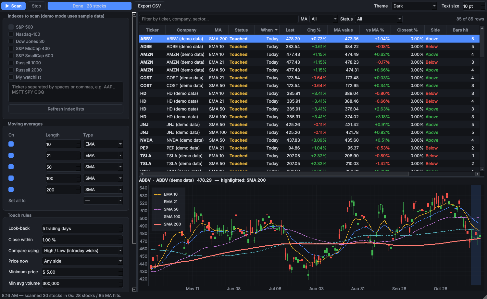

# MA Touch Scanner

A desktop app that scans the major US stock indexes and shows which stocks have recently **touched or come close to a key moving average**: the 10, 21, 50, 100 and 200 by default. Pullbacks to the 21 EMA or tests of the 200 SMA all show up in one sortable list, with a chart for each hit.



## Features

- **Indexes:** S&P 500, Nasdaq-100, Dow Jones 30, S&P MidCap 400, S&P SmallCap 600, Russell 1000, Russell 2000, plus your own watchlist. Pick any combination.
- **Five moving averages, each fully adjustable.** Turn each one on or off, change its length (2–500), and choose its type:
  - **SMA**: simple
  - **EMA**: exponential
  - **WMA**: linearly weighted
  - **HMA**: Hull
  - **VWMA**: volume-weighted
  - **DEMA**: double exponential
  - **TEMA**: triple exponential

  "Set all to" switches every MA type in one click.
- **Look-back of 1–10 trading days.** 1 = today's bar only.
- **"Close within" tolerance.** A bar within X % of the MA counts as *near*. A bar whose high–low range crosses the MA counts as *touched*.
- **Compare using** intraday highs/lows (wicks) or closing prices only. In close-only mode, a close that crosses the MA is shown as *Crossed*.
- **Price now** filter: any side, above the MA (support tests / pullbacks), or below it (resistance tests).
- **Minimum price and minimum 50-day average volume** filters to skip illiquid names.
- **Results table:** sort and filter by ticker, company, sector, MA or status. Right-click a row to open it on TradingView, Yahoo Finance or Finviz, or to copy tickers. Double-click opens TradingView. You can export the table to CSV.
- **Chart panel:** candlesticks with every enabled MA, the matched MA drawn thicker, and the look-back window shaded.
- **Themes:** Dark, Midnight Blue, Night Shift (warm, low blue light), OLED Black, High Contrast, Light and Solarized Light. Text size is adjustable from 8 to 18 pt.
- **Alerts:** auto-scan every 15 min – 4 h, optionally only while the US market is open. A desktop notification lists the stocks that are **new** since the last scan; new rows are starred ★ in the table.
- All settings are remembered between sessions.

## Download (no Python needed)

Ready-to-run builds are made by GitHub Actions:

1. Open the repo's **Actions** tab → **Build desktop app** → **Run workflow**. Pushing a tag such as `v1.0.0` also publishes a Release.
2. When the run finishes, download the build for your system from the run page (or from **Releases** for tagged builds):
   - **Windows:** `MA-Touch-Scanner-Windows.exe`. If SmartScreen warns you, click *More info → Run anyway* (the app is not code-signed).
   - **macOS:** unzip `MA-Touch-Scanner-macOS.zip`, then right-click **MA Touch Scanner.app → Open** the first time (unsigned app).
   - **Linux:** `chmod +x MA-Touch-Scanner-Linux && ./MA-Touch-Scanner-Linux`

## Run from source

```bash
python -m venv .venv
# Windows: .venv\Scripts\activate     macOS/Linux: source .venv/bin/activate
pip install -r requirements.txt
python main.py            # live data
python main.py --demo     # offline demo with made-up prices
python -m pytest -q       # unit tests
```

Requires Python 3.10 or newer.

## How a "touch" is decided

For each stock and each enabled MA, the app checks the last *N* daily bars (the look-back):

| Result | Rule (High / Low mode) |
|---|---|
| **Touched** | the bar's low ≤ MA ≤ the bar's high |
| **Near** | the closest edge of the bar is within *Close within %* of the MA |

The table shows the most recent qualifying bar. A real touch takes priority over a later near-miss.

The table columns mean:

- **When:** how many bars ago the touch or near-miss happened.
- **Closest %:** the smallest gap during the window.
- **vs MA %:** where the price sits now relative to the MA.
- **Bars hit:** how many bars in the window qualified.

## Data sources and limits

- **Prices:** daily bars from Yahoo Finance via the [`yfinance`](https://github.com/ranaroussi/yfinance) library. The data is free and unofficial, usually delayed about 15 minutes during the session. Today's bar is still forming until the close.
- **Index members:** downloaded from Wikipedia, Nasdaq, iShares ETF holdings and a public S&P 500 dataset, then cached for 7 days. Use **Refresh index lists** to force an update. The Dow 30 also has a built-in list in case those sources are down.
- **Scan time:** a large scan (for example the Russell 2000) downloads around 2,000 histories and can take a few minutes. Yahoo may throttle very frequent requests, so keep auto-scan at 15 minutes or longer.
- **Settings and caches** are stored in your user app-data folder.

This tool is for research only. It is not investment advice.
